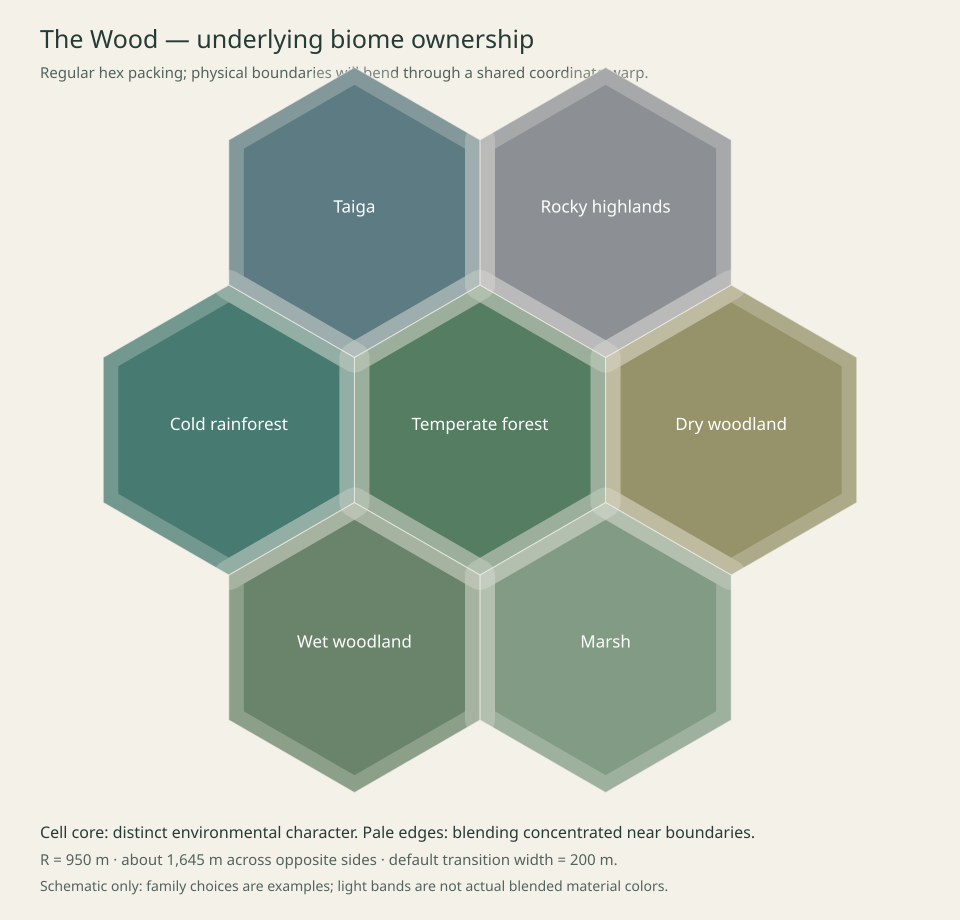

# The Wood — biome cells, boundaries and discovery generation

Design specification · 6 October 2026

This is the proposed next generation architecture, following the request for efficiently packed hexagonal biome cells and edge-local blending. It supersedes the intended regional layout in the earlier prototype plan. The current runtime now has the initial hex ownership and edge-weight foundation, the climate table and adjacency rule, fresh-identity forgetting, and save/resume (section 10). The weighted compatibility pass, boundary contracts, drainage and discovery catalog described here remain future implementation. The full experience remains defined in [Specification.md](Specification.md), implementation evidence in [Status.md](Status.md), the [biome roster](BiomeCatalog.md), and planned discovery content in [DiscoveryCatalog.md](DiscoveryCatalog.md).

## 1. What a cell means

A biome cell is a large place with an identifiable environmental character, enough room to wander within it, and neighboring places that can be reached by walking in different directions. It owns climate and ecological intentions, discovery planning, and a regional lighting clock. It is neither a rendering chunk nor an isolated level.

Use a regular hexagonal lattice for underlying ownership. It packs the plane without holes, gives each cell six equal-distance neighbors, and has no special north/east axes. Do not expose hexagons through paths, tree lines, hills, or visible straight borders. A gentle continuous coordinate warp makes the actual boundaries irregular. A cell's interior remains recognizably itself; blends are concentrated at its edges rather than washing all regions together.

The three relevant scales remain separate:

| Scale | Starting default | Responsibility |
| --- | --- | --- |
| Biome cell | 950 m corner radius; about 1,645 m across opposite sides | Climate family, character, regional light, discoveries |
| Small habitat | Approximately 15–120 m, with occasional larger clearings/wetlands | Fern colonies, moss pockets, grass patches, sheltered hollows |
| Terrain/rendering chunk | Existing 128 m square, 2 m ground vertices initially | Meshes, collision, instancing and streaming work |

At 4.2 m/s, an unobstructed side-to-side crossing takes about 6.5 minutes. Moderate route bends produce the desired six-to-eight-minute typical crossing. Corner crossings, steep routes and time spent observing vary. This is a starting size, not a claim about measured playtests. A cell occupies roughly 2.34 square kilometres; typical crossing time must be measured along generated walking routes before tuning the radius.

The first hex implementation uses a fixed cell radius. Variation comes from warped shapes, routes, terrain, and optional groups of neighboring cells with related character. Arbitrarily varying independent hex radii is deferred because it breaks regular packing. Later, bounded cell merges can create exceptionally large regions while retaining six-neighbor geometry for the constituent ownership cells. A merged region generally has more than six external neighboring regions; its adjacency list must be derived from its constituent cells.

## 2. Coordinates and complete coverage

Use pointy-top hexes, axial integer coordinates `(q,r)`, and cube coordinates `(q,r,-q-r)` for distance and rounding. For radius `R` in metres:

- Center X = `sqrt(3) * R * (q + r/2)`.
- Center Y = `1.5 * R * r`.
- Neighbor offsets = `(1,0), (1,-1), (0,-1), (-1,0), (-1,1), (0,1)`.
- Inverse fractional coordinates: `q = sqrt(3)*X/(3*R) - Y/(3*R)` and `r = 2*Y/(3*R)`.

Round through cube coordinates, correcting the coordinate with the greatest rounding error so the three rounded coordinates sum to zero. Specify a deterministic coordinate-order tie-break on exact boundaries. This must work for negative coordinates, not merely positive integer casts.

Let `W(p)=p+D(p)` be a continuous, seed-derived warp from physical world coordinates to cell-layout coordinates. All ownership and edge-distance queries use the same `W`. Use at least C1-continuous noise so blend and height derivatives can remain continuous. Begin with displacement capped at 8% of R (76 m) and wavelengths at least one cell across. Enforce a displacement-field Lipschitz bound below 0.25, including summed octaves. This keeps the map invertible and prevents folded boundaries, holes and duplicated ownership. Reduce amplitude automatically if the chosen noise construction cannot meet that bound. A slow spatial bend is preferable to visibly turbulent borders.

For any world point, compute the nearest hex center in warped space and inspect an axial radius-two neighborhood: at most 19 candidate cells. Geometry and candidate enumeration require no neighboring Unreal actors to exist. Queries use integer identifiers and immutable value records, including pending descriptors.

## 3. Edge-local blending

Cell ownership is exact and gap-free. Environmental influence is soft. Keep these separate so a feature has one owner even when its surroundings blend three biomes.

Every neighboring pair owns an undirected edge key, with the two cell identifiers sorted canonically. Its boundary contract contains a blend half-width, boundary profile inputs, channel crossings, route connections and reservations. The two endpoints read the same record. Begin with a half-width of 100 m, tunable from 60–150 m according to the biome pair and local terrain: a full transition of 120–300 m, or roughly 30–70 seconds of unobstructed walking. These widths are deliberately narrower than a cell interior.

In warped space, signed distance from cell i toward the bisector with neighbor j is:

`margin(i,j,p) = (|p-center(j)|^2 - |p-center(i)|^2) / (2*|center(j)-center(i)|)`.

The margin is positive on i's side. For each candidate i, divide each of its six margins by that edge's shared half-width. Apply `smoothstep(-1,1,margin/halfWidth)` separately to every edge and multiply those six factors to get a raw influence. Normalize all positive raw influences to sum to one. Inside a cell more than every relevant half-width from its edges, its weight is one and other weights are zero. At the middle of a shared edge each incident cell contributes raw weight 0.5; at an exact three-cell vertex each incident cell contributes raw weight 0.25, normalizing to one third each. The product avoids the derivative kink introduced by taking a minimum across edges. With C1-continuous inputs and a positive normalization denominator, the weight field is C1-continuous. Use a stable ownership fallback only for numerical underflow, and log it in development builds.

Normalization is essential at corners: sequentially blending A into B and then into C produces order-dependent results. Do not mix height, ground color, lighting and plant habitat through unrelated boundary functions. They consume the same influence vector, while categorical choices use that vector as probabilities.

The warp changes physical transition width slightly. Sample its Jacobian when checking widths and limit effective widths to the authored range; review actual crossings from both directions. Never create straight strips of alternating plants along the exact hex edge.

## 4. Regional descriptions and neighbor relationships

Generate a complete regional description before terrain or vegetation. Store at least:

| Field | Meaning |
| --- | --- |
| Cell coordinate and generation identity | Topological address versus this particular incarnation of the place |
| Family and subfamily | Broad climate/ecology plus a readable local variant |
| Physical origin, cell radius and warp inputs | Shared ownership geometry, independent of mesh chunks |
| Temperature, moisture and season character | Environmental character without survival mechanics |
| Roughness, elevation intent and drainage tendency | Baseline structural behavior, not independent ground meshes |
| Canopy openness, exposure, shelter, substrate | Inputs to habitat and composition |
| Tree maturity distribution | Regeneration patches, intermediate growth and established canopy; no growth simulation |
| Lighting phase, period, color-temperature range | Independently progressing regional atmosphere |
| Ruin eligibility and unreal eligibility | Independent flags, with their own random streams |
| Architectural/geological palette references | Compatible authored assets and generation recipes |
| Discovery intents and boundary-contract keys | Reserved sites and agreements with neighbors |

Family assignment uses smooth world-space climate fields (temperature, moisture, exposure, broad elevation tendency) plus cell-specific variation. Select families through weighted suitability rather than choosing each cell uniformly from a biome list. Neighbor relationships influence the choice through fields and symmetric compatibility weights, not through whichever neighbor happened to load first. Use one bounded compatibility pass: first compute a base family probability vector from climate suitability for the target cell and its six neighbors. For each target family f, multiply its suitability by `epsilon + mean_over_neighbors(sum_over_g(baseNeighborProbability(g) * Compatibility(f,g)))`; normalize and select using the cell's own random stream. Compatibility is a symmetric, nonnegative authored table, and epsilon keeps rare candidates possible. Base vectors require only local climate queries. Final chosen neighbor families are never recursively consulted. This provides soft preferences rather than hard adjacency guarantees; generation order cannot change the result. Hard constraints would require a separately specified bounded solver and are not part of this default.

Practical relationships include prairie/savannah to dry woodland or rocky uplands; temperate forest to cool rainforest, forested highlands or wetlands; taiga to icy hills or cold rainforest; swamp to marsh or wet woodland. Unusual adjacency remains possible through a suitable ecotone. Do not forbid novelty so tightly that exploration becomes predictable.

A cell is not homogeneous. Its dominant family controls the overall read, while terrain and habitat fields create riparian vegetation, exposed grass, sheltered moss, wet hollows and dry ridges within it. Small habitats do not require additional full-size hex cells. A related cluster can share a broad climate while varying openness, landforms, substrate and discoveries.

Constructed discoveries�ruins, intact structures and anomalous objects�are eligible independently in approximately one third of generated cells. Unreal character is eligible independently in approximately one tenth. Neither flag changes cell ownership or causes abrupt boundary cuts. Their random streams are independent of each other and of asset variant selection, so adding a grass asset does not reroll a region's ruin status. These are long-run probabilities, not an exact repeating three-cell or ten-cell pattern. A cell can contain both. An anomalous structure is not restricted to unreal-flagged cells: the flag describes sustained environmental character, not the object�s historical genre.

## 5. Ordered generation and shared structural inputs

Generate shared intentions before details. Each stage consumes prior outputs and emits value records that can be computed off the main thread.

1. **Regional planning:** resolve candidate cells, descriptions, influence weights and canonical shared boundary contracts.
2. **Structural planning:** establish broad relief, ridges, ravines, outcrop footprints, catchments, channel paths, walkable connections and discovery reservations. Reserve ruin foundations here rather than dropping a ruin onto finished grass.
3. **Terrain realization:** construct continuous ground from shared structural fields and fit rock formations. Honor channel and foundation constraints. Queries and collisions must use the realized triangle surface.
4. **Hydrology:** realize continuous channels and pools, fit banks and beds, and derive depth, wetness and riparian zones. Hydrology can request constrained terrain adjustments before final mesh/collision commit.
5. **Habitat and discovery realization:** place tree cohorts, plants, surface detail and complete discovery assemblies using terrain, water and reservations. Fit roots and rock footprints. Foundation vegetation yields to walls, paths and collapse debris.
6. **Presentation:** apply light, weather, wind, sound and later wildlife from the same descriptions and simulated time.

Terrain must not be made by blending unrelated finished heightfields at their edges. Shared ridges and drainage provide the structure; biome weights modulate roughness, erosion character and ecological response. A ridge can cross multiple cells while its vegetation and substrate change along the way.

Water crosses a cell edge through an agreed channel record: position, tangent, width, water elevation, bed elevation and flow direction. The downstream endpoint cannot invent a new height or disconnected stream. Use bounded macro-catchments spanning several biome cells, with outlet constraints and an acyclic internal drainage graph. An outlet may be a lake, marsh or continuing macro-channel. Define the macro network before local channels; do not determine drainage by recursively generating every downstream cell. Contracts between catchments also need a strict decreasing outlet potential and agreeing water/bed elevations: an internally acyclic basin is insufficient if two basins drain into each other. The macro planner must determine potential and an admissible downstream connection through bounded local queries. If no lower valid outlet is available, terminate locally as a basin/lake/wetland rather than forcing an uphill connection or searching indefinitely. A full macro-drainage potential construction remains a separate implementation design task; cross-basin acyclicity, bounded evaluation and compatible elevations are acceptance requirements before that stage ships. The first migration retains the existing continuous stream as an explicit structural test while broader catchment generation is implemented separately.

Each ordinary cell must support traversal through its interior and onward into neighbors. Reserve multiple optional walking connections rather than one enforced corridor. Ridges and water can make some directions inconvenient; they must not leave the player in a sealed basin. Validate reachability on a slope/depth-aware traversal grid, not merely Euclidean center distances. Repair constraints algorithmically, never by hand-placing a ramp for one seed.

## 6. Discoveries, props and composition

A discovery is an authored procedural recipe plus a site, not a bag of randomly scattered meshes. Examples include a broken bridge with matching abutments and a stream underneath, a fern-filled courtyard with its drainage and light opening, or a boulder cleft with sheltered ground cover. The catalog defines many possible recipes; a particular cell uses only a few.

Default composition budget: one principal landmark intention, zero to two secondary discoveries, and sparse small incidental details. A principal landmark may simply be a ridgeline, old tree grove or stream bend; not every cell needs a conspicuous constructed attraction. Constructed-discovery-eligible cells usually use a ruin, intact building or anomalous object as their principal or secondary discovery. Quiet stretches must remain common. These counts are tunable composition budgets, not compulsory checklists.

A recipe declares biome suitability, scale range, footprint, required terrain/water/light relationships, approach directions, exclusion distances, traversal constraints, architectural or object family, preservation/damage/overgrowth state, asset dependencies and streaming bounds. Site selection scores multiple deterministic candidates. Use separate candidate streams for different feature types and reserve accepted footprints before plants are generated. Resolve competing sites by stable feature priority and identifier rather than job completion order.

Large rock formations shape terrain early. Small fitted stones decorate it later. Ruin placement can level a constrained foundation, but must retain terrain-aware supports and believable drainage. A stream bridge reserves a crossing and banks before either water or masonry is realized. Collapsed walls require corresponding debris and ground contact; vegetation should respond to exposed rubble versus sheltered interiors. The same recipe must generate meaningful variations without arbitrary per-part yaw noise destroying architecture.

If an eligible ruin has no valid large site, select a smaller compatible recipe or revise its reservation within bounded retries. Do not silently stamp a huge ruin onto a cliff. Record failed site reasons so the approximate one-third frequency can be audited and corrected.

Unreal character is a coherent layer: unusual fungi, light absorption, pale groves, mineral glow or unfamiliar fauna may reinforce one chosen motif. Limit a cell to one main unreal idea plus restrained supporting changes. Its edge influence fades with regional weights, and its physical structures remain grounded. Exaggerated atmosphere is allowed; visible holes and broken meshes are not.

## 7. Feature records and runtime ownership

Every realized discovery has a stable identity, owning cell incarnation, recipe/version, transform, world-space bounds, dependency keys, structural constraints and state. Asset fragments and plants can be partitioned into square rendering chunks without becoming separate discoveries.

A ruin that spans a chunk boundary remains one planned assembly. Its transform and damage choices never reroll when a neighboring chunk arrives. Load and retain pieces based on their bounds and visibility, not solely on the owner's center. Collision must not disappear while the player is inside the assembly. Distant landmark silhouettes require lightweight retained representations when full-detail chunks are absent.

Cache regional and edge descriptors at cell scale. Sample influence and habitat grids once per prepared chunk and interpolate where accuracy permits; use exact realized triangles for final grounding. Background jobs hold immutable value snapshots. Mesh creation, material changes and physics commit remain on the game thread with bounded realization work. Asset variation must not force one component per plant.

The hex migration preserves the current square terrain-chunk scheduler. Changing region geometry does not justify replacing all streaming, photography or observation code at once.

## 8. Seeds, forgetting and resume

Debug generation is reproducible for a session seed, committed cell incarnations, edge contracts and recipe version. Generation order must not change outputs. During ordinary play, sufficiently distant, fully unseen and unreferenced cells eventually lose their incarnations. A future visit to that topological address receives a fresh generation identity. A coordinate hash alone cannot implement this forgetting requirement.

Retain visible landmarks, nearby backtracking geography, pending jobs and any cell referenced by a live boundary/feature. Forgetting requires all those protections to expire. When a fresh cell adjoins a retained one, preserve the retained boundary contract and a guard strip, then generate its interior against those constraints. Never alter terrain the player can still see to accommodate a newly rolled neighbor.

Boundary contracts remain alive while either incident incarnation or a visible shared feature needs them. Store first-committed contracts explicitly; canonical identities provide order-independent initial creation, while retained contracts constrain replacements. Save/resume records retained incarnations, contracts, relevant features, lighting/weather state, pending identities and recipe versions. Do not promise reconstructing a whole session from one seed after forgotten identities have been discarded.

Fresh-identity forgetting and save/resume are implemented (section 10). Boundary contracts and retained-edge replacement remain future work.

## 9. Validation and migration order

### Geometric and deterministic checks

- Complete coverage and unique ownership at centers, edges, corners, negative and far coordinates.
- Six reciprocal neighbors, canonical undirected edge keys and correct axial/cube rounding.
- Warp has no folds; tested Jacobian bounds and effective cell sizes remain within limits.
- Weights sum to one; clear interior cores are preserved; all three influences blend at corners without discontinuities.
- Cross the same edge from both directions: height, normals, water, light and habitat agree.
- Generate adjacent chunks/cells in different orders and compare output records and actual shared geometry.
- Ruin/unreal frequencies and independence pass statistical checks across many cell identities.

### Exploration and composition checks

- Measure side-to-side walking times and connected route availability over multiple seeds.
- Check actual ground contact, blocked routes, usable crossings, foundation support and water direction.
- Inspect discovery approaches, recognizable look-back silhouettes, repeated compositions and quiet intervals.
- Walk while streaming, sit at an edge, accelerate time and photograph blends without exposure jumps.
- Retain cross-chunk assemblies and landmarks correctly; test fresh-cell regeneration against a retained edge.
- Profile prepared-job cost, main-thread commit spikes, memory retention and packaged frame times.

### Incremental implementation

1. Add engine-independent hex coordinates, ownership and edge-weight tests while keeping the current renderer.
2. Replace broad square-lattice influences with hex descriptions and edge-local blends. Keep four existing family palettes and the current stream as continuity fixtures.
3. Add site reservations and a small initial set of discovery recipes: a ridge/outcrop overlook, boulder cleft, stream crossing, ruined stone enclosure and overgrown courtyard. Expand only after these read well at human scale.
4. Add macro-catchments and shared drainage contracts with explicit reachability validation.
5. Expand climate families and architectural kits; introduce coherent unreal motifs.
6. Add fresh identities, retained-edge replacement and save/resume, with visibility-based forgetting tests.

This order changes one important source of complexity at a time. Hex ownership, terrain chunks, discoveries and irreversible forgetting have separate contracts and separate acceptance evidence.

## 10. Implemented contracts (as of 8 October 2026)

Sources: `Source/TheWood/Private/Generation/WoodGeneration.cpp`, `WoodMemory.cpp`, `WoodSave.cpp`; `Source/TheWood/Private/WoodWorld.cpp`, `WoodWorldStreaming.cpp`; constants in `Public/Generation/WoodSalts.h` and `WoodHex.h`. Where this section and sections 1-9 differ, this section describes the code.

### Pipeline stages

`World::generate(x, y, includeFeatures)` calls these stages in this order:

| Order | Stage | Reads | Produces |
| --- | --- | --- | --- |
| 1 | terrain | Settings, x, y | Vertex heights and triangles. Always run, even when features are skipped. |
| 2 | region | Settings, x, y | Chunk bounds and the hex owner of the chunk midpoint. |
| 3 | structure | region | Discovery reservations and chunk-local discovery pieces. |
| 4 | hydrology | terrain | Stream centre and half-width per terrain row. |
| 5 | habitat | region, structure | Ecological feature layers. Its hydrology argument is not read. |
| - | presentation | terrain, habitat, structure | `Chunk`: habitat features, then structure pieces. |

The header declaration order differs from this call order. The call order is the one that applies.

**Order-independence rule:** `generate(x, y)` depends only on Settings, the epoch source and `(x, y)`. No stage may read state left by another chunk or an earlier call. `GenerationTests` checks this with eight fixed-seed shuffles of a 3x3 chunk block, comparing per-chunk fingerprints against an in-order run.

### Region flags and climate families

Each hex region is described by `describe()`. It uses `regionSeed(q, r)`, so its values change with its epoch (see Forgetting).

**Flags.** Both are independent, with their own salts:
- `unreal`: `hash % 1000 < 100`, so p = 0.10 (salt `RegionUnreal`, 716). It is computed but nothing in `Source` reads it yet, so it has no generation or visual effect.
- `ruins`: `hash % 3000 < 1000`, so p = 1/3 (salt `RegionRuins`, 717). Discovery planning consumes it.

**Climate fields.** Each is `0.5 + 0.5 * noise(...)` at the hex centre `(q/6, r/6)`, keyed by the region seed:
- temperature01 (salt `ClimateTemperature`, 1009)
- moisture01 (salt `ClimateMoisture`, 1013)
- relief (salt `ClimateRelief`, 1019)

**Base table**, applied in this order:
1. temperature01 < 0.30: Taiga
2. moisture01 < 0.35: DryGrassland
3. relief > 0.62: RockyHighlands
4. otherwise: TemperateForest

**Origin overrides** (fixed, not sampled): `(0,0)` and `(-1,0)` TemperateForest; `(1,0)` and `(0,1)` DryGrassland; `(1,1)` and `(1,-1)` RockyHighlands; `(0,-1)` Taiga.

**Adjacency contract.** `allowedAdjacent` forbids only DryGrassland with Taiga, symmetrically. In `regionFamily()`, a cell compares its base-table family with each of its six neighbours' base-table family (or origin override). On a forbidden pair, the cell yields to TemperateForest if its key is lower. The key is the hash of the cell's region seed with the RegionFamily salt, then `q`, then `r`. Origin cells never yield, so the free neighbour does. The rule is a single pass on base families. Final neighbour families are never consulted. It is a hard pairwise rule, not the weighted compatibility pass described in section 4.

**Per-family constants** from `describe()`:

| Family | Moisture | Roughness | Temperature (C) | Canopy | Exposure |
| --- | --- | --- | --- | --- | --- |
| TemperateForest | 0.78 | 0.22 | 16 | 0.96 | 0.18 |
| DryGrassland | 0.24 | 0.16 | 24 | 0.055 | 0.86 |
| RockyHighlands | 0.38 | 0.85 | 8 | 0.09 | 0.94 |
| Taiga | 0.58 | 0.36 | -3 | 0.70 | 0.38 |

Family enum order is TemperateForest, DryGrassland, RockyHighlands, Taiga. The blend weights of `Surface.biome[]` follow that order.

### Forgetting

- **Clock.** Observation uses the shared observation clock (`ObservationSeconds`), not wall time. It advances at 1x, or 20x while seated and accelerated.
- **Observation.** On each streaming step, `UpdateForgetting()` observes every region touched by a retained chunk. A chunk touches its four corners and centre. Observed regions get `lastSeen = now` and are no longer marked forgotten.
- **Trigger.** A region that was seen at least once, is not touched this step, is not already forgotten, and has been absent for at least `ForgetGraceSeconds` gets its epoch incremented. The default is 90 s, the `UPROPERTY` on `AWoodWorld`. The grace is measured from `lastSeen`.
- **Epoch to seed.** `regionSeed(q, r)` is `Settings.seed` at epoch 0. At epoch > 0 it is `hash(seed, q, r, RegionEpoch + epoch)`, with `RegionEpoch = 0xE90C0000`.
- **Hex lattice.** `regionOwner()` depends on the seed only. Epochs never move cell ownership.
- **Epoch source.** Generation reads an immutable snapshot passed to `setEpochs()`. Background jobs copy the `World`, so each keeps the snapshot it was given.
- **Stale jobs.** In-flight jobs that touch a forgotten region are discarded and never realized. The invariant that no resident chunk touches a forgotten region is asserted with `ensureMsgf`.
- **Changes on forget:** region identity, family, the climate values in the per-family table, lighting phase, the unreal and ruins flags, discovery planning and habitat. Per-cell ground amplitude also changes, because `ground()` weights its highland, prairie and broad terms by the family and roughness of nearby regions. The terrain shape near a forgotten cell can therefore change.
- **Stays:** the `Settings.seed`-keyed noise fields and the stream centreline (`streamX` uses `Settings.seed` only), the hex lattice, chunk layout, and chunks owned only by distant epoch-0 regions, which `GenerationTests` checks as byte-identical.

### Save/resume

- **File.** `<ProjectSavedDir>/Wood/resume.json`, set by `AWoodWorld::ResumePath`. Writes go to `resume.json.tmp` first.
- **Write.** The temp file is moved over the target, then read back. The write succeeds only if the text matches and `fromJson` parses it. `SaveResumeNow()` writes synchronously. `RequestResumeSave()` writes on a background thread. One write runs at a time, and a newer payload replaces any queued one.
- **Format.** Compact JSON, fixed key order:
  - `version`, `seed`
  - `playerX`, `playerY`, `playerZ`, `yaw`, `pitch`
  - `clockSeconds`, `seated`, `accelerated`, `enteredWild`
  - `retainedChunks`: array of `{x, y}`
  - `epochs`: array of `{q, r, epoch}`, only regions with epoch > 0
- **Version.** `version` is 1 and `kSupportedVersion` is 1. The reader rejects version < 1 or > 1. Any parse failure starts the session fresh and logs a warning. Unknown keys are ignored. Missing keys keep their defaults.
- **Numbers.** Doubles use `max_digits10`, so they round-trip exactly. A non-finite double is written as `null`, and the reader rejects it.
- **Saved but not restored.** `seed` is written, but `ApplyResume` does not read it. The generator seed comes from the `Seed` property or `-WoodSeed`. `enteredWild` is in the schema but the runtime never sets it, so it is always false.
- **Load.** On `BeginPlay`, before generation: clock, seated and accelerated state, region epochs (`Memory.restore` and generator epochs), the player transform, and prefetch of `retainedChunks`.
- **Triggers:**
  - `EndPlay`: synchronous write, if ready.
  - Autosave: every 60 s of wall time while not seated, checked in `Tick`.
  - Standing up from a seat: background write.
  - A streaming step that forgets at least one region: background write.
  - Explicit `SaveResumeNow()`.
- **`-WoodFresh`.** Disables loading and all saves. `RequestResumeSave()` and `SaveResumeNow()` return without writing. An existing file is neither read nor deleted.
